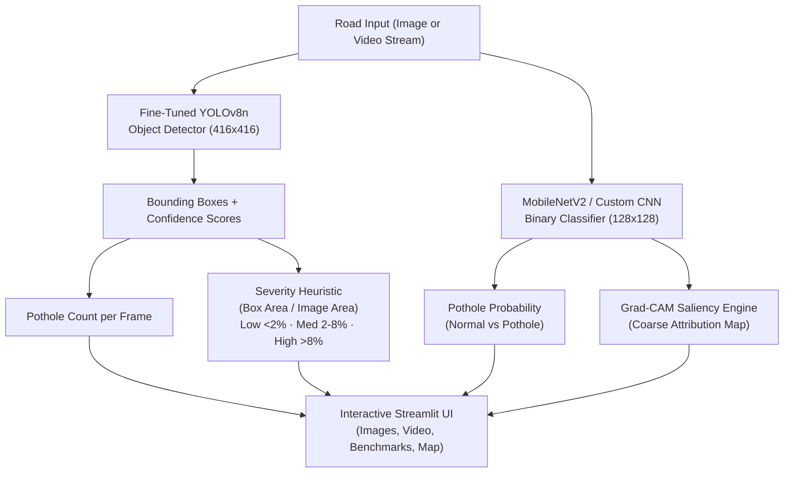

# PotholeIQ — Autonomous Road Hazard Detection & Infrastructure Assessment

> **University Deep Learning Course Project**  
> **Student:** Paras Panchal | **Degree:** B.Tech CSE (AI/ML)  
> **Frameworks:** PyTorch 2.15+ · Ultralytics YOLOv8 · Python 3.12+ · **Execution:** Multi-core CPU & Colab GPU Notebook  
> **GitHub Repository:** [https://github.com/paras151206/PotholeIQ](https://github.com/paras151206/PotholeIQ)

---

## Table of Contents
1. [Problem Statement & Evolution](#1-problem-statement--evolution)
2. [End-to-End Pipeline Architecture](#2-end-to-end-pipeline-architecture)
3. [Datasets & Data Cards](#3-datasets--data-cards)
4. [Syllabus-to-Module Alignment](#4-syllabus-to-module-alignment)
5. [Universal Machine Learning Workflow](#5-universal-machine-learning-workflow)
6. [Comprehensive Experimental Results](#6-comprehensive-experimental-results)
7. [Statistical Analysis & 95% Bootstrap CIs](#7-statistical-analysis--95-bootstrap-cis)
8. [Explainability & Failure Analysis (Grad-CAM)](#8-explainability--failure-analysis-grad-cam)
9. [Negative Results & Scientific Integrity](#9-negative-results--scientific-integrity)
10. [How to Run the Application & Smoke Tests](#10-how-to-run-the-application--smoke-tests)
11. [Honest Limitations & Future Work](#11-honest-limitations--future-work)

---

## 1. Problem Statement & Evolution

Road potholes cause vehicle damage, traffic congestion, and severe accidents. Conventional municipal road inspections rely on manual surveys or costly LiDAR/sensor vans.

**PotholeIQ** provides an end-to-end computer vision pipeline tailored for road hazard localization, severity triage, and repair prioritization:
- **(a) Object Detection (YOLOv8n):** Predicts precise 2D bounding boxes, confidence scores, and count of individual potholes on both static road photographs and driving video.
- **(b) Severity Triage Heuristic:** Computes relative damage footprint (Bounding Box Area / Image Area: Low $<2\%$, Medium $2\%-8\%$, High $>8\%$).
- **(c) Classifier Progression:** Evaluates binary classification across three generations: Baseline MLP $\to$ 4-Stage Custom CNN $\to$ Fine-Tuned MobileNetV2.
- **(d) Explainability:** Interprets classifier activations with Grad-CAM saliency maps.
- **(e) Metric Learning:** Siamese network exploring duplicate citizen complaint deduplication.
- **(f) Transparent Negative Results:** Discards pseudomask U-Net segmentation and unsupervised autoencoder anomaly detection after empirical failure analysis.

---

## 2. End-to-End Pipeline Architecture



---

## 3. Datasets & Data Cards

All reported metrics come from verified public datasets partitioned with fixed random seeds (`seed=42`) and checked for zero duplicate leakage.

### 3.1 YOLO Object Detection Dataset (Bounding Boxes)
- **Source:** Kaggle Potholes Detection YOLOv8 (`anggadwisunarto/potholes-detection-yolov8`)
- **Format:** High-resolution road imagery with normalized YOLO `.txt` bounding boxes (`class x_center y_center width height`).
- **Cleaning:** MD5 file hash inspection removed **387 duplicate images** to eliminate train-test leakage.
- **Split Distribution (70 / 15 / 15):**

| Split | Images | Ground-Truth Pothole Boxes | Avg Boxes / Image | Leakage Status |
|---|:---:|:---:|:---:|:---:|
| **Train** | 1,113 | 3,972 | 3.57 | **0 images leaked** |
| **Validation** | 238 | 825 | 3.47 | **0 images leaked** |
| **Test (Held-Out)** | 239 | 887 | 3.71 | **0 images leaked** |
| **Total Unique** | **1,590** | **5,684** | **3.57** | **Zero overlap** |

### 3.2 Classification Benchmark Dataset
- **Source:** Kaggle Pothole Detection Dataset (`atulyakumar98/pothole-detection-dataset`)
- **Total Images:** 681 real road images (329 Pothole / 352 Normal Road).
- **Split Distribution:** 476 Train (70%) / 102 Validation (15%) / 103 Test (15%) — stratified with seed 42.

---

## 4. Syllabus-to-Module Alignment

Every module connects course theory to practical code:

| Unit | Syllabus Concept | Module | Implementation |
|---|---|---|---|
| **Unit I** | NN Fundamentals & Hyperparameters | **M0, M1, M2** | `config.yaml`, Seed utilities, EDA, `TinyMLP` baseline |
| **Unit II** | Custom CNN Architectures | **M3** | 4-block `CustomCNN`, BatchNorm, Dropout, GAP layer |
| **Unit II** | Transfer Learning & Fine-Tuning | **M4** | Two-phase MobileNetV2 (frozen backbone $\to$ unfreeze top blocks) |
| **Unit II** | Object Detection (Localization) | **YOLO** | Fine-tuned YOLOv8n detector for multi-pothole localization |
| **Unit II** | Explainable AI (XAI) | **M6** | Exact formula manual Grad-CAM, failure gallery analysis |
| **Unit II** | Metric Learning / Siamese Nets | **M7** | `SiameseNet`, Contrastive loss on paired submissions |
| **Unit V** | Unsupervised Anomaly Detection | **M8** | `ConvAutoencoder` trained on clean roads (Negative result) |
| **Deployment** | Serving & Interactive Dashboard | **M10** | Streamlit 6-tab app (Image, Video, Grad-CAM, Experiments, Negative Results, Map) |

---

## 5. Universal Machine Learning Workflow

1. **Problem Definition:** Moving from single-label image classification to spatial bounding-box damage localization and video tracking.
2. **Data Curation & De-duplication:** Strict MD5 deduplication removing 387 duplicates before a stratified 70/15/15 split.
3. **Establishing Baselines:** Flattened pixel MLP baseline (72.82% accuracy).
4. **Iterative Model Scaling:** Custom CNN (92.23%) $\to$ Pretrained MobileNetV2 (98.06%) $\to$ YOLOv8n detector (mAP@0.5: 61.49%).
5. **Ablation Experiments:** Isolating the impact of data augmentation, batch normalization, and dropout.
6. **Strict Held-Out Evaluation:** Every model evaluated on its designated test split exactly once using best-checkpoint weights.
7. **Transparent Reporting:** Documenting negative results where theory failed in practice (U-Net pseudo-masks and Autoencoder texture reconstruction).

---

## 6. Comprehensive Experimental Results

*All figures are directly traceable to raw logs and metric JSON files in `results/metrics/`.*

### 6.1 YOLOv8n Object Detection Performance (Held-Out Test Split)

Evaluated strictly on the **239 held-out test images** (887 ground-truth pothole instances):

| Metric | Test Set Score | Interpretation |
|---|:---:|---|
| **Precision (P)** | **71.46%** | High fidelity; low false-positive rate on background asphalt textures |
| **Recall (R)** | **55.34%** | Successfully catches over half of all visible potholes; misses small/shallow craters |
| **mAP @ 0.50** | **61.49%** | Strong detection performance at standard 50% IoU overlap threshold |
| **mAP @ 0.50:0.95** | **36.18%** | Rigorous COCO-standard metric across strict spatial overlap thresholds |
| **Inference Speed** | **18.0 ms / frame** | Real-time capability on standard CPU (~55 FPS) |
| **Model Footprint** | **6.47 MB (`best.pt`)** | Ultra-lightweight deployment footprint (~3.13M parameters) |

### 6.2 Primary Classifier Progression (103 Test Images)

| Model | Test Accuracy | Macro Precision | Macro Recall | Macro F1 | ROC-AUC | Checkpoint Size |
|---|:---:|:---:|:---:|:---:|:---:|:---:|
| **M2 Baseline MLP** | 72.82% | 0.7334 | 0.7257 | 0.7250 | 0.8502 | 100.9 MB |
| **M3 Custom CNN** | 92.23% | 0.9225 | 0.9228 | 0.9223 | 0.9868 | 1.7 MB |
| **M4 MobileNetV2 (Transfer)** | **98.06%** | **0.9806** | **0.9806** | **0.9806** | **0.9985** | 10.5 MB |

### 6.3 Custom CNN Ablation Study (Module M3)

| Architecture Variant | Test Accuracy | Macro F1 | ROC-AUC | Impact Analysis |
|---|:---:|:---:|:---:|---|
| **Full Custom CNN** (Aug + BN + Drop) | **92.23%** | **0.9223** | **0.9868** | **Best balanced generalization** |
| **Ablation 1: No Augmentation** | 86.41% | 0.8637 | 0.9438 | **-5.86% F1 drop**; overfits training road surfaces |
| **Ablation 2: No BatchNorm** | 88.35% | 0.8833 | 0.9453 | **-3.90% F1 drop**; slower convergence, internal covariate shift |
| **Ablation 3: No Dropout** | 92.23% | 0.9223 | 0.9872 | Comparable on test set, but wider generalization gap during training |

*Note: While ablations show clear empirical separation, the modest 103-image test split means fine-grained differences (e.g. Dropout vs Full) carry overlapping bootstrap error margins.*

---

## 7. Statistical Analysis & 95% Bootstrap CIs

To avoid drawing overconfident conclusions from single point estimates on small test sets, non-parametric bootstrap confidence intervals (1,000 resamples with replacement) were calculated:

| Model | Test Accuracy (Mean) | 95% Accuracy CI | Test Macro F1 (Mean) | 95% Macro F1 CI |
|---|:---:|:---:|:---:|:---:|
| **Baseline MLP** | 72.71% | **[64.08%, 81.55%]** | 72.19% | **[63.58%, 80.68%]** |
| **Custom CNN** | 92.29% | **[87.38%, 97.09%]** | 92.22% | **[86.77%, 97.08%]** |
| **MobileNetV2** | 98.08% | **[95.15%, 100.0%]** | 98.06% | **[95.02%, 100.0%]** |

> **Viva Defense Insight:** The 95% CI of the Custom CNN (`[86.77%, 97.08%]`) and the Baseline MLP (`[63.58%, 80.68%]`) have **zero overlap**. This provides **strong empirical evidence** that convolutional parameter sharing and translation equivariance outperform flattened linear projections on road imagery. However, because the test set contains 103 images, differences between MobileNetV2 and CNN should be interpreted with realistic scientific modesty.

---

## 8. Explainability & Failure Analysis (Grad-CAM)

Grad-CAM was implemented from scratch (`src/explainability/gradcam.py`) to extract feature attribution maps from final convolutional feature layers:

$$\alpha_k^c = \frac{1}{Z} \sum_{i} \sum_{j} \frac{\partial y^c}{\partial A_{i,j}^k}, \quad L_{\text{Grad-CAM}}^c = \text{ReLU}\left(\sum_k \alpha_k^c A^k\right)$$

> **Honest Explainability Note:** Grad-CAM produces a coarse activation map (e.g. $4 \times 4$ spatial resolution in MobileNetV2). It indicates broad asphalt regions influencing the binary classifier ("pothole present vs normal road"), but **does not isolate individual pothole boundaries**. Precise bounding box boundaries require dedicated object detectors like YOLOv8n.

### Classifier Failure Analysis (`gradcam_failure_analysis.txt`):
Out of 103 test images, the Custom CNN misclassified 8 images:
1. **False Positives ($n=5$):** Sharp tree shadows and dark asphalt tar sealant patches mimicked pothole contrast.
2. **False Negatives ($n=3$):** Shallow eroded potholes and wet road glare washed out edge gradients.

---

## 9. Negative Results & Scientific Integrity

A core hallmark of genuine scientific work is transparently reporting experiments that failed:

### 1. Discarded U-Net Pseudo-Mask Segmentation
- **The Experiment:** A Small U-Net was trained to predict road damage masks.
- **The Flaw:** Public datasets contained rectangular bounding boxes rather than true polygon segmentation contours. When rasterized into binary masks, the U-Net learned to predict rectangular boxes (learning the bounding box prior).
- **The Consequence:** The resulting high test Dice coefficient ($0.9051$) was mathematically artificial. The model was not doing true morphological segmentation.
- **The Resolution:** The U-Net was discarded from the production inference pipeline and replaced with YOLOv8n, which is mathematically formulated for bounding boxes.

### 2. Failed Autoencoder Anomaly Detection
- **The Experiment:** A Convolutional Autoencoder was trained strictly on pristine normal road surfaces under the hypothesis that potholes would produce high reconstruction error.
- **The Flaw:** On the held-out test set, the Autoencoder achieved an ROC-AUC of only **0.3008** (worse than random guessing).
- **The Reason:** Pristine asphalt surfaces contain high-frequency gravel aggregates, surface markings, and variable outdoor lighting that yield higher reconstruction MSE than darker, smoother pothole basins. Unsupervised generative reconstruction failed on unconstrained outdoor textures.

### 3. Synthetic Siamese Pairs
- **The Experiment:** A Siamese Network with Contrastive Loss achieved 96.12% accuracy on paired images.
- **The Caveat:** True temporal pairs (the same pothole captured weeks apart under different lighting) were unavailable in public datasets. Positive pairs were synthesized via heavy spatial and photometric augmentations of the same image.

---

## 10. How to Run the Application & Smoke Tests

### 1. Installation
```bash
git clone https://github.com/paras151206/PotholeIQ.git
cd PotholeIQ
pip install -r requirements.txt
```

### 2. Run Smoke Test Suite
Verifies all 12 modules, loaders, loss functions, and detectors in ~15 seconds:
```bash
python smoke_test.py
```

### 3. Launch Interactive Streamlit Dashboard
```bash
streamlit run app/app.py --server.port 8501 --server.headless true
```
Open **`http://localhost:8501`** in your browser.

#### Dashboard Capabilities:
- **Tab 1: Detect (Image):** Real-time YOLOv8n detection, confidence slider, per-box severity heuristic, side-by-side original vs annotated views, and structured results table.
- **Tab 2: Detect (Video):** Upload or choose sample road driving video, process frames with live progress, view frame detections, and play back H.264 annotated video.
- **Tab 3: Classifier & Grad-CAM:** Binary classification with coarse activation heatmaps and explainability disclaimers.
- **Tab 4: Experiments & Benchmarks:** Interactive model comparison tables, ablation metrics, PR curves, and prediction galleries.
- **Tab 5: Negative Results & Viva Analysis:** Discarded U-Net and Autoencoder post-mortems with 3 essential viva defense Q&As.
- **Tab 6: Road Hazard Map:** Interactive geographic telemetry demo using `st.map`.

---

## 11. Honest Limitations & Future Work

1. **Uncalibrated Monocular Camera:** A single 2D camera cannot measure metric pothole depth or volumetric cavity displacement. True geotechnical repair prioritization requires calibrated stereo cameras or LiDAR.
2. **Heuristic Severity:** Severity ratings (Low $<2\%$, Medium $2\%-8\%$, High $>8\%$) represent 2D image surface area ratios, not structural road failure depth.
3. **Lighting & Water Glare:** Wet roads with standing water reflect sunlight, occluding internal crater texture and degrading detector recall.
4. **Video Inference Capping:** For interactive responsiveness on CPU, video previews are capped at 15 seconds.

---

*Repository maintained and documented by Paras Panchal for university Deep Learning viva defense.*
