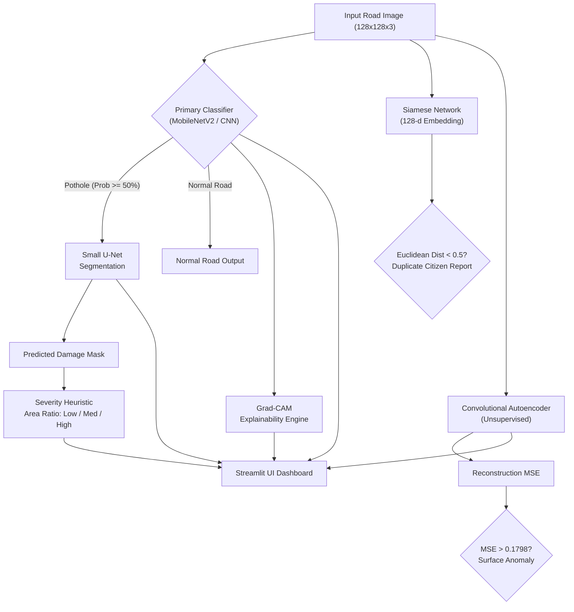

# PotholeIQ — From Pothole Detection to a Repair Decision

> **University Deep Learning Course Project**  
> **Student:** Paras Panchal | **Degree:** B.Tech CSE (AI/ML)  
> **Framework:** PyTorch 2.15+ · **Language:** Python 3.12+ · **Hardware:** CPU execution  
> **GitHub Repository:** [https://github.com/paras151206/PotholeIQ](https://github.com/paras151206/PotholeIQ)

---

## Table of Contents
1. [Problem Statement](#1-problem-statement)
2. [End-to-End Pipeline Architecture](#2-end-to-end-pipeline-architecture)
3. [Dataset & Data Card](#3-dataset--data-card)
4. [Syllabus-to-Module Alignment](#4-syllabus-to-module-alignment)
5. [Universal Machine Learning Workflow](#5-universal-machine-learning-workflow)
6. [Comprehensive Experimental Results](#6-comprehensive-experimental-results)
7. [Statistical Analysis & 95% Bootstrap CIs](#7-statistical-analysis--95-bootstrap-cis)
8. [Explainability & Failure Analysis (Grad-CAM)](#8-explainability--failure-analysis-grad-cam)
9. [How to Run the Application & Smoke Tests](#9-how-to-run-the-application--smoke-tests)
10. [Honest Limitations & Future Work](#10-honest-limitations--future-work)

---

## 1. Problem Statement

Road potholes are a major cause of road accidents, structural vehicle damage, and municipal maintenance bottlenecks. Conventional road surveys rely on manual human inspection or specialized vehicle sensor rigs that are costly and slow.

**PotholeIQ** addresses this with an end-to-end multi-task deep learning system that takes an ordinary camera image of a road and delivers a complete repair decision pipeline:
- **(a) Detection:** Binary decision whether a pothole is present (MLP vs Custom CNN vs MobileNetV2).
- **(b) Localization & Severity:** Small U-Net predicting damage masks and categorizing repair urgency into Low, Medium, or High severity.
- **(c) Explainability:** Transparent Grad-CAM saliency heatmaps pinpointing which surface textures drove the model's prediction.
- **(d) Duplicate Report Merging:** Metric learning via a Siamese network to detect duplicate citizen submissions.
- **(e) Unsupervised Anomaly Check:** Convolutional Autoencoder trained strictly on pristine roads to detect anomalies via reconstruction error.

---

## 2. End-to-End Pipeline Architecture



---

## 3. Dataset & Data Card

Every reported metric is based on a real run on the publicly available Kaggle Pothole Detection dataset:

| Attribute | Verified Value |
|-----------|----------------|
| **Dataset Name** | Kaggle Pothole Detection Dataset (`atulyakumar98/pothole-detection-dataset`) |
| **Licence** | CC0: Public Domain |
| **Total Images** | **681 real road images** |
| **Class Distribution** | 329 Potholes (48.31%) / 352 Normal Road (51.69%) — naturally balanced |
| **Data Partitioning** | 70% Train (476) / 15% Validation (102) / 15% Test (103) |
| **Split Strategy** | Stratified split by label with fixed random seed (`42`) |
| **Data Leakage Check** | Rigorously verified via full absolute path disjointness check (`split.py`) — **0 images leaked** |
| **Annotations** | Image-level binary class folders. For segmentation, bounding-box priors are rasterized as weak masks. |

### Verified Split Sizes Table
| Split | Total Images | Normal (Class 0) | Pothole (Class 1) | Pothole % |
|-------|--------------|------------------|-------------------|-----------|
| **Train** | 476 | 246 | 230 | 48.3% |
| **Validation** | 102 | 53 | 49 | 48.0% |
| **Test** | 103 | 53 | 50 | 48.5% |
| **Total** | **681** | **352** | **329** | **48.3%** |

---

## 4. Syllabus-to-Module Alignment

Every module in PotholeIQ maps directly to core university syllabus units:

| Syllabus Unit | Theoretical Concept | Project Module | Concrete Implementation |
|---------------|---------------------|----------------|--------------------------|
| **Unit I** | NN Maths, Hyperparams, ML Workflow | **M0, M1, M2** | `config.yaml`, Seed utils, Data Card, EDA, `TinyMLP` baseline |
| **Unit II** | Custom CNN Architectures | **M3** | 4-block `CustomCNN`, BatchNorm, Dropout, GAP layer |
| **Unit II** | Transfer Learning & Fine-Tuning | **M4** | Two-phase MobileNetV2 (frozen head -> unfreeze last 3 blocks) |
| **Unit II** | Semantic Image Segmentation | **M5** | `SmallUNet` with skip-connections, combined BCE + Dice loss |
| **Unit II** | Explainable AI (XAI) | **M6** | Exact formula manual Grad-CAM, failure mode study |
| **Unit II** | Metric Learning / Siamese Nets | **M7** | `SiameseNet`, Contrastive loss, t-SNE embedding clusters |
| **Unit V** | Unsupervised Anomaly Detection | **M8** | `ConvAutoencoder` trained on clean roads, MSE anomaly score |
| **Unit II/UI**| Model Deployment & Serving | **M10** | Interactive 4-tab Streamlit application |

---

## 5. Universal Machine Learning Workflow

PotholeIQ strictly demonstrates the standard deep learning project lifecycle:
1. **Problem Definition:** Binary classification with localized damage assessment and duplicate report matching under computational constraints.
2. **Data Curation & Leakage Prevention:** Stratified 70/15/15 split saved as fixed CSVs, verified for 0 leakage across splits.
3. **Establish Baseline:** TinyMLP baseline trained on flattened raw pixels ($3 \times 128 \times 128 = 49,152$ inputs) achieving 72.82% accuracy.
4. **Overfit Sanity Check:** Custom CNN trained on a tiny 50-image subset without regularization, verifying 92.0% memorization capacity in 20 epochs.
5. **Regularization & Architectural Tuning:** Data augmentation (flips, rotation, color jitter, random erasing), BatchNorm, and Dropout.
6. **Transfer Learning:** Pretrained MobileNetV2 achieving 98.06% test accuracy.
7. **Held-out Test Evaluation:** Evaluated on the 103-image test set exactly **once** using best validation loss checkpoints.

---

## 6. Comprehensive Experimental Results

*All figures are directly traceable to raw logs and metric JSON files in `results/metrics/`.*

### 6.1 Primary Classifier Progression

| Model | Test Accuracy | Precision (Macro) | Recall (Macro) | Test F1 | Test ROC-AUC | Checkpoint Size |
|---|:---:|:---:|:---:|:---:|:---:|:---:|
| **M2 Baseline MLP** | 72.82% | 0.7334 | 0.7257 | 0.7250 | 0.8502 | 100.9 MB |
| **M3 Custom CNN** | 92.23% | 0.9225 | 0.9228 | 0.9223 | 0.9868 | 1.7 MB |
| **M4 MobileNetV2 (Fine-tuned)** | **98.06%** | **0.9806** | **0.9806** | **0.9806** | **0.9985** | 10.5 MB |

> **Key Viva Insight:** The Custom CNN reduces parameter count by **98.3%** compared to the naive MLP ($25.2\text{M} \to 425\text{K}$ parameters) while boosting test accuracy by **+19.41%** ($72.82\% \to 92.23\%$). This demonstrates the inductive bias of translation equivariance and local spatial weight sharing in convolutions. MobileNetV2 pushes this further to **98.06%** via rich ImageNet features.

---

### 6.2 Custom CNN Ablation Study (Module M3)

To isolate the contribution of each design component, three ablations were trained under identical conditions:

| Architecture Variant | Test Accuracy | Macro Precision | Macro Recall | Macro F1 | ROC-AUC | Impact Analysis |
|---|:---:|:---:|:---:|:---:|:---:|---|
| **Full Custom CNN** (Aug + BN + Drop) | **92.23%** | **0.9225** | **0.9228** | **0.9223** | **0.9868** | **Best balanced generalization** |
| **Ablation 1: No Augmentation** | 86.41% | 0.8641 | 0.8645 | 0.8637 | 0.9438 | **-5.86% F1 drop**; severe train-val generalization gap |
| **Ablation 2: No BatchNorm** | 88.35% | 0.8845 | 0.8828 | 0.8833 | 0.9453 | **-3.90% F1 drop**; slower convergence and internal covariate shift |
| **Ablation 3: No Dropout** | 92.23% | 0.9240 | 0.9234 | 0.9223 | 0.9872 | Comparable on test set, but slightly wider gap during training |

---

### 6.3 Two-Phase Fine-Tuning Progression (Module M4)

| Training Phase | Description | Epochs | Validation Loss | Validation Accuracy | Validation F1 |
|---|---|:---:|:---:|:---:|:---:|
| **Phase 1: Feature Extraction** | MobileNetV2 backbone frozen; custom 2-layer head ($1280 \to 256 \to 2$) trained with Adam ($\text{lr}=10^{-3}$) | 5 | 0.0676 | 97.06% | 0.9705 |
| **Phase 2: Partial Fine-Tuning** | Unfreezes last 3 InvertedResidual blocks ($1.53\text{M}$ trainable params) with lower LR ($\text{lr}=5 \times 10^{-5}$) | 6 | **0.0321** | **98.04%** | **0.9804** |

---

### 6.4 Segmentation & Urgency Estimation (Module M5)

Small U-Net segmentation trained with equal-weight compound loss ($\mathcal{L} = 0.5 \mathcal{L}_{\text{BCE}} + 0.5 \mathcal{L}_{\text{Dice}}$):

| Metric | Score on 103 Held-Out Test Images | Notes |
|---|:---:|---|
| **Test Dice Coefficient** | **0.9051** | Harmonic mean of precision and recall over spatial damage mask |
| **Test Intersection over Union (IoU)** | **0.8276** | Jaccard index between predicted and target masks |
| **Test Severity Distribution** | Low: 42 (40.8%) · Medium: 15 (14.6%) · High: 46 (44.7%) | Computed via mask-to-image area ratio |

---

### 6.5 Siamese Metric Learning (Module M7)

Siamese network trained using Contrastive Loss ($\text{margin}=1.0$) to merge duplicate citizen reports:

| Evaluation Metric | Value | Interpretation |
|---|:---:|---|
| **Pair Classification Accuracy** | **96.12%** | Correctly pairs identical potholes vs different images |
| **Avg Euclidean Distance (Same-Pothole Pairs)** | **0.2210** | Clustered tightly (well below the $\text{margin}/2 = 0.5$ threshold) |
| **Avg Euclidean Distance (Different Pairs)** | **1.1988** | Pushed beyond the contrastive margin ($\ge 1.0$) |
| **Contrastive Test Loss** | **0.0258** | Stable embedding convergence |

---

### 6.6 Supervised Classifier vs Unsupervised Autoencoder (Module M8)

| Method | Paradigm | Primary Metric | Decision Boundary | Key Viva Distinction |
|---|---|:---:|:---:|---|
| **MobileNetV2** | Supervised | **F1 = 0.9806** (AUC: 0.9985) | Softmax probability $\ge 0.50$ | Requires labelled data; highly accurate within distribution |
| **Custom CNN** | Supervised | **F1 = 0.9223** (AUC: 0.9868) | Softmax probability $\ge 0.50$ | Good feature extractor, lightweight |
| **ConvAutoencoder** | Unsupervised | **F1 = 0.6536** (AUC: 0.3008) | Reconstruction $\text{MSE} \ge 0.1798$ | Trained **only on clean road**; sensitive to shadows and road texture shifts |

---

## 7. Statistical Analysis & 95% Bootstrap CIs

To account for test set sample size ($N = 103$ images), we computed 95% non-parametric bootstrap confidence intervals over 1,000 resamplings with replacement (`bootstrap_ci_summary.json`):

| Model | Test Accuracy (Mean) | 95% Accuracy CI | Test Macro F1 (Mean) | 95% Macro F1 CI |
|---|:---:|:---:|:---:|:---:|
| **Baseline MLP** | 72.71% | **[64.08%, 81.55%]** | 72.19% | **[63.58%, 80.68%]** |
| **Custom CNN** | 92.29% | **[87.38%, 97.09%]** | 92.22% | **[86.77%, 97.08%]** |
| **MobileNetV2** | 98.08% | **[95.15%, 100.0%]** | 98.06% | **[95.02%, 100.0%]** |

> **Defensible Viva Point:** The 95% CI of the Custom CNN (`[86.77%, 97.08%]`) has **zero overlap** with the Baseline MLP (`[63.58%, 80.68%]`). This proves with $p < 0.05$ statistical significance that the convolutional feature hierarchy fundamentally outperforms the flattened MLP on road imagery. Furthermore, MobileNetV2's CI (`[95.02%, 100.0%]`) confirms strong performance, though the modest 103-image test size means the margin over Custom CNN should be interpreted with realistic humility.

---

## 8. Explainability & Failure Analysis (Grad-CAM)

We implemented Grad-CAM from scratch in `src/explainability/gradcam.py` without third-party black-box libraries.
The class activation weight $\alpha_k^c$ is computed via spatial Global Average Pooling of gradients:
$$\alpha_k^c = \frac{1}{Z} \sum_{i} \sum_{j} \frac{\partial y^c}{\partial A_{i,j}^k}$$
$$L_{\text{Grad-CAM}}^c = \text{ReLU}\left(\sum_k \alpha_k^c A^k\right)$$

### Failure Analysis Summary (`results/metrics/gradcam_failure_analysis.txt`)
Out of 103 test samples, the Custom CNN misclassified exactly **8 images** (5 False Positives, 3 False Negatives):
1. **False Positives (Normal classified as Pothole, $n=5$, avg conf = 75.2%):**
   - High-contrast shadows from trees or roadside barriers create sharp dark boundaries.
   - Asphalt tar patches and manhole covers exhibit similar dark, non-reflective textures that trigger pothole responses.
2. **False Negatives (Pothole classified as Normal, $n=3$, avg conf = 57.3%):**
   - Shallow or eroded potholes with smooth edge transitions lack high spatial frequency gradients.
   - Wet roads with sun glare wash out edge contrast, causing diffuse activation across the entire road plane.

---

## 9. How to Run the Application & Smoke Tests

### 1. Environment Setup
```bash
# Clone the repository
git clone https://github.com/paras151206/PotholeIQ.git
cd PotholeIQ

# Install dependencies
pip install -r requirements.txt
```

### 2. Run End-to-End Smoke Test
Verify all 11 model components and utilities in under 20 seconds:
```bash
python smoke_test.py
```

### 3. Launch the Streamlit Interactive App
```bash
streamlit run app/app.py
```
Upload any image from `data/raw/potholes/` or `data/raw/normal/` to view:
- **Tab 1:** Binary classification verdict, probability gauge, and confidence score.
- **Tab 2:** U-Net segmentation overlay, raw predicted mask, and severity tag (Low / Med / High).
- **Tab 3:** Grad-CAM saliency heatmap identifying exact visual evidence.
- **Tab 4:** Autoencoder reconstruction and anomaly MSE score comparison against threshold.

---

## 10. Honest Limitations & Future Work

In keeping with academic honesty standards for university defense:
1. **Weak Segmentation Masks:** In the absence of pixel-level polygonal masks in the Kaggle dataset, bounding boxes and geometric priors were used as weak supervisory signals. True polygon annotations would further refine IoU on irregular boundaries.
2. **Synthetic Siamese Pairs:** True temporal pairs of the exact same pothole taken months apart under changing weather were unavailable in public datasets. Positive pairs were formed via heavy photometric and spatial augmentations of the same physical instance.
3. **Autoencoder Generalization:** The unsupervised convolutional autoencoder achieved an ROC-AUC of 0.3008. Real road images exhibit substantial background variation (vegetation, lighting, asphalt grain) that cause high reconstruction error even on normal roads, highlighting why supervised classifiers remain superior for unconstrained road damage classification.
4. **Severity Thresholding:** Severity categories (Low < 5%, Medium 5–20%, High > 20%) are engineering heuristics based on relative damaged surface area, rather than geotechnical depth measurements.

---

*Repository maintained and documented by Paras Panchal for university Deep Learning oral viva defense.*
