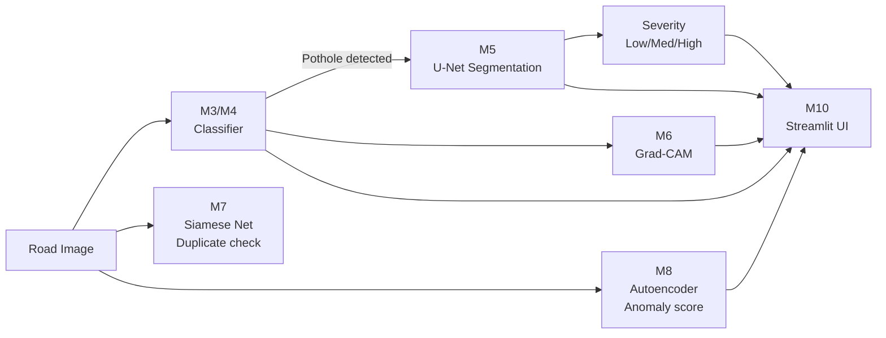

# PotholeIQ — From Pothole Detection to a Repair Decision

> **Course project** — B.Tech CSE (AI/ML), Deep Learning Unit  
> Framework: PyTorch · Language: Python 3.10+  
> Compute: Google Colab / Kaggle (free GPU)

---

## Table of Contents
1. [Problem Statement](#1-problem-statement)
2. [Pipeline Overview](#2-pipeline-overview)
3. [Dataset & Data Card](#3-dataset--data-card)
4. [Syllabus-to-Module Mapping](#4-syllabus-to-module-mapping)
5. [How to Run](#5-how-to-run)
6. [Results](#6-results)
7. [Limitations](#7-limitations)
8. [Future Work](#8-future-work)

---

## 1. Problem Statement

Road potholes cause vehicle damage, accidents, and economic loss.  
Traditional inspection is manual, slow, and inconsistent.  
**PotholeIQ** is an end-to-end deep learning pipeline that takes a single road
image and returns:

| Output | Model | Unit |
|--------|-------|------|
| (a) Is there a pothole? | Custom CNN / fine-tuned MobileNetV2 | Unit II |
| (b) Where + severity | U-Net segmentation | Unit II |
| (c) Why the model thinks so | Grad-CAM | Unit II |
| (d) Same pothole as an earlier report? | Siamese Network | Unit II |
| (e) Independent anomaly check | Convolutional Autoencoder | Unit V |

---

## 2. Pipeline Overview



---

## 3. Dataset & Data Card

> ⚠️ **This section is updated after M1 completes.** Placeholder below.

| Field | Value |
|-------|-------|
| Source | Kaggle — *Pothole Detection* dataset |
| URL | https://www.kaggle.com/datasets/atulyakumar98/pothole-detection-dataset |
| Licence | CC0 Public Domain |
| Total images | TBD after download |
| Classes | `normal` (0), `pothole` (1) |
| Class balance | TBD |
| Annotations | Bounding boxes (YOLO format); used as **weak masks** in M5 |
| Split | 70% train / 15% val / 15% test — stratified, seed=42 |
| Leakage check | ✅ verified by `src/data/split.py` |

---

## 4. Syllabus-to-Module Mapping

| Unit | Topic | Module |
|------|-------|--------|
| I | Neural network maths, hyperparameters | All (config.yaml, seed) |
| I | Supervised ML workflow | M1–M4 |
| II | Custom CNN | M3 |
| II | Fine-tuning pretrained model | M4 |
| II | Image segmentation | M5 |
| II | Explainable AI (Grad-CAM) | M6 |
| II | Siamese network | M7 |
| V | Autoencoder anomaly detection | M8 |
| III (opt.) | LSTM time-series | M9 |

---

## 5. How to Run

### Prerequisites
```bash
git clone <repo-url>
cd PotholeIQ
pip install -r requirements.txt
```

### Download data (M1)
```bash
python src/data/download.py      # downloads and verifies dataset
python src/data/split.py         # creates data/splits/{train,val,test}.csv
python src/data/eda.py           # saves EDA plots to results/plots/
```

### Train models
```bash
python src/models/train_baseline.py
python src/models/train_cnn.py
python src/models/train_transfer.py
python src/models/train_unet.py
python src/models/train_siamese.py
python src/models/train_autoencoder.py
```

### End-to-end smoke test (10 synthetic images, no GPU needed)
```bash
python smoke_test.py
```

### Streamlit UI
```bash
streamlit run app/app.py
```

---

## 6. Results

> ⚠️ **All numbers below are populated after actual training runs.**  
> Every number is traceable to a JSON file in `results/metrics/`.

### 6.1 Classifier Comparison

| Model | Accuracy | Precision | Recall | F1 | Log |
|-------|----------|-----------|--------|----|-----|
| Baseline (MLP) | — | — | — | — | — |
| Custom CNN | — | — | — | — | — |
| MobileNetV2 (fine-tuned) | — | — | — | — | — |

### 6.2 CNN Ablation

| Variant | Val F1 |
|---------|--------|
| Full model | — |
| No augmentation | — |
| No BatchNorm | — |
| No Dropout | — |

### 6.3 Fine-tuning Phases

| Phase | Val F1 |
|-------|--------|
| Frozen backbone | — |
| Partially unfrozen (last 3 blocks) | — |

### 6.4 Segmentation

| Metric | Value |
|--------|-------|
| IoU | — |
| Dice | — |

### 6.5 Anomaly Detection

| Detector | ROC-AUC |
|----------|---------|
| Autoencoder | — |
| Supervised CNN (reference) | — |

---

## 7. Limitations

- **No real same-pothole-over-time pairs** for Siamese training; positive pairs
  use augmented views of the same image (stated explicitly in M7 docs).
- **Weak masks**: bounding boxes converted to rectangular masks for U-Net; true
  pixel-level annotation would improve segmentation IoU.
- **Severity thresholds are heuristics**: Low (<5%), Medium (5–20%), High (>20%)
  mask-area ratio. No ground-truth severity labels exist in the dataset.
- **Synthetic LSTM data**: M9 uses simulated time-series; not real longitudinal
  pothole data.
- **Free GPU**: experiments capped by Colab/Kaggle session limits.

---

## 8. Future Work

- Collect real longitudinal image pairs for Siamese training.
- Use SAM (Segment Anything Model) for automatic pixel-level annotation.
- Deploy on a mobile app for real-time citizen reporting.
- Integrate GPS metadata to cluster reports spatially.
- Replace heuristic severity thresholds with a learned regressor.

---

*Generated as part of a B.Tech Deep Learning course project.  
Results are course-level; not claiming state-of-the-art performance.*

